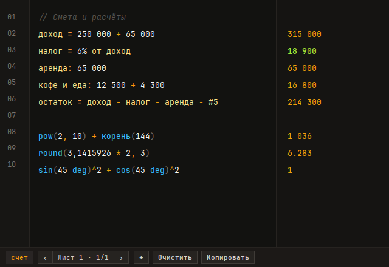
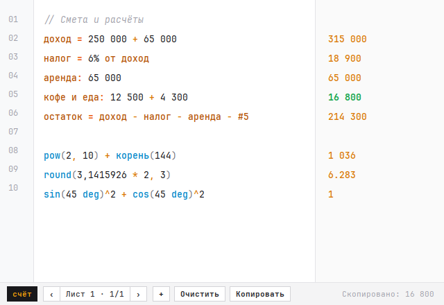

# счёт (`schet`)

**Блокнотный калькулятор на чистом Rust + GTK3 для тех, кто устал кормить отдельный браузер шестью сотнями мегабайт оперативки ради того, чтобы поделить счёт за пиццу или прикинуть налог.**

`счёт` вдохновлён [Numara Calculator](https://github.com/bornova/numara-calculator) и Soulver, но выкидывает за борт Electron, Chromium, Node.js, WebKitGTK и две тысячи пакетов из `node_modules`. Взамен — один нативный бинарник весом **472 КБ**, холодный старт быстрее кадра твоего монитора и **12.6 МБ** собственной памяти.




---

## Зачем это нужно (в цифрах, а не обещаниях)

Мы честно пытались пойти компромиссным путём и сначала пересадили фронтенд Numara (`mathjs` + `CodeMirror`) на Tauri / Wry поверх системного `WebKitGTK`. Спойлер: браузерный движок остаётся браузерным движком, даже если приклеить к нему шильдик «Rust».

Реальные замеры по `/proc/<pid>/smaps_rollup` на одной и той же странице расчётов (Arch Linux / Wayland / Niri):

| Вариант | Стек | Процессы | Размер бинарника | RSS (общая) | PSS | Private Dirty (реально сожрано) |
| :--- | :--- | :---: | :---: | :---: | :---: | :---: |
| **Numara (`numara-bin`)** | Electron 45 + Chromium + V8 | 6 | ~180 МБ | 738.2 МБ | 378.9 МБ | **178.6 МБ** |
| **Wry / Tauri прототип** | Rust + WebKitGTK 4.1 + JavaScriptCore | 4 | 3.5 МБ | 509.9 МБ | 361.8 МБ | **225.7 МБ** |
| **`счёт` (`schet`)** | **Rust + GTK3 (нативный рендер и парсер)** | **1** | **472 КБ** | **73.6 МБ** | **34.0 МБ** | **12.6 МБ** |

Никаких фоновых воркеров, сетевых запросов, телеметрии, автоапдейтеров и скрытых заголовков окон. Открыл — посчитал — скопировал ответ кликом.

---

## Что умеет движок

Собственный рекурсивный парсер (`src/eval.rs`) без единой внешней математической зависимости понимает живой человеческий текст вперемешку с формулами:

- **Переменные и метки на русском и английском:**
  ```text
  доход = 250 000 + 65 000        -> 315 000
  налог = 6% от доход             -> 18 900
  аренда: 65 000                  -> 65 000
  кофе и еда: 12 500 + 4 300      -> 16 800
  доход += 50к                    -> 365 000
  ```
- **Числа с пробелами и запятыми без боли при копипасте:**
  Скопировал `315 000` из колонки ответов или банковской выписки и вставил обратно в формулу? `счёт` не развалится и поймёт группировку разрядов (`250 000 + 65 000`), суффиксы (`15k`, `250к`, `2.5m`, `1.2м`, `1b`), шестнадцатеричные (`0xff`), двоичные (`0b1010`) числа и десятичную запятую (`3,14 * 2`), при этом не путая её с разделителем аргументов в `round(3,1415926 * 2, 3)` или `pow(2,10)`.
- **Проценты по-человечески:**
  - `1250 + 20%` → `1 500`
  - `1250 - 20%` → `1 000`
  - `20% of 1250` / `6% от 250к` / `15% из 80 000`
  - `120 / (1 + 20%)` → `100`
- **Ссылки на строки и агрегации по блокам:**
  - `#1`, `#5`, `line2`, `строка1` — подставить результат конкретной строки.
  - `prev`, `ans`, `_`, `пред`, `ответ` — результат предыдущей вычисленной строки.
  - `sum` / `total` / `сумма` / `итого` и `avg` / `mean` / `среднее` — сумма или среднее по текущему блоку строк (до пустой строки) либо по переданным аргументам.
- **Математические функции и градусы:**
  - `sqrt` (`корень`), `cbrt`, `abs` (`модуль`), `round(x, [n])` (`окр`), `floor`, `ceil`, `trunc`
  - `pow(a, b)` (`степень`), `min(...)` (`мин`), `max(...)` (`макс`), `fact(n)` и постфиксный факториал `5!`
  - `sin`, `cos`, `tan`, `asin`, `acos`, `atan`, `sinh`, `cosh`, `tanh`, `ln`, `log`, `log2`, `log10`, `exp`
  - Постфикс `deg` / `°` / `град`: `sin(45 deg)^2 + cos(45°)^2` → `1`
  - Целочисленное деление `10 // 3` → `3` и остаток `10 % 3` / `10 mod 3` → `1` (умно отличает `10 // 3` от текстового комментария `250к // зарплата`).

---

## Интерфейс и управление

- **Дизайн Amber Field без верхних рамок:** всё окно — чистый холст с нумерацией строк (`01`, `02`...) и колонкой ответов справа, а все элементы управления собраны в лаконичной нижней полосе. Перетаскивать окно можно прямо за нижнюю панель.
- **Живая синхронизация темы с системой:** автоматически переключается между графитовой тёмной (`#121210`, янтарные ответы `#F59E0B`, лаймовый ховер `#A3E635`) и чистой белой светлой темой (`#FFFFFF`, янтарно-золотые ответы `#D97706`, изумрудный ховер `#16A34A`) без перезапуска окна.
- **Копирование в один клик:** наведи курсор на любой ответ в правой колонке — он подсветится цветом, а клик мгновенно отправит число в системный буфер обмена.
- **Листы и автосохранение:** все расчёты и листы (`Лист 1`, `Лист 2`...) на лету сохраняются в `~/.local/share/schet/state.json`.

### Горячие клавиши

| Сочетание | Действие |
| :--- | :--- |
| **Клик по ответу справа** | Скопировать конкретный ответ в буфер обмена |
| **`Ctrl + N`** | Создать новый лист |
| **`Ctrl + PageUp` / `Alt + Left`** | Переключиться на предыдущий лист |
| **`Ctrl + PageDown` / `Alt + Right`** | Переключиться на следующий лист |
| **`Ctrl + L`** | Очистить текущий лист (повторное нажатие на пустом листе удаляет его) |
| **`Ctrl + Q` / `Ctrl + W`** | Закрыть окно |

---

## Сборка и установка

Понадобятся только стандартный тулчейн Rust (`cargo`) и системные заголовки `gtk3`.

```bash
git clone https://github.com/mqrkin/schet.git
cd schet
cargo test
cargo build --release

# Установка бинарника в ~/.local/bin
install -Dm755 target/release/schet ~/.local/bin/schet
```

## Лицензия

[MIT](LICENSE)
